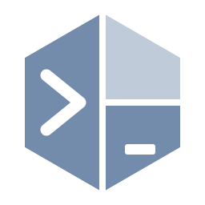

<div align="center">
  
  <h1>pocketosix</h1>
  <p><strong>real unix vibe right in your browser!</strong></p>
</div>

**English** · [Русский](README.ru.md)

A real Alpine Linux userspace, Xorg and i3 desktop running on your device through CheerpX — not a simulated terminal. Your browser hosts the desktop and its local writable disk; guest networking through Tailscale is optional.

## Quick start

Requires **Node.js ≥ 20.9** (Node.js 24 recommended), npm and a recent desktop Chrome or Edge.

```powershell
npm install
npm run dev
```

Open **[localhost:3000/run](http://localhost:3000/run)** to skip the landing page, then click **`> boot`**. Opening the page does not start Linux. The guest GUI needs no Tailscale account.

## Open the local desktop

After installing dependencies, use this instead of `npm run dev`:

```powershell
npm run desktop
```

Starts the installed Next.js dev server with webpack at port **3000** and opens `/run` in your default browser only after the server reports ready and the route returns HTTP 200. You still click **`> boot`** yourself.

An occupied port is an error: the launcher does not reuse another server or silently switch your storage origin. If your server is already running, open `/run` manually. **Ctrl+C** stops only the launcher's own server.

[Local launch, apps, tty1 and i3 floating controls →](docs/desktop.md)

Panels and the tty1 console overlay Linux without resizing it; the active desktop uses the guest cursor only. Actual viewport changes settle for 150 ms; framebuffer dimensions are capped at 4096 px per axis. [Display and input controls](docs/desktop.md#управление-на-run).

## Apps and guest windows

The shell has **seven panels**: Apps, Display, Terminal, Disk, Network, Shortcuts and Logs. The new controls below describe the current implementation **under verification**, not a real-guest test result or measured speedup.

- **Apps → Linux terminal** launches guest `xterm` inside Xorg/i3. **Terminal → Open terminal** opens the browser's separate, real **tty1 console**; it does not launch that GUI terminal.
- **All applications** uses `rofi -normal-window -show drun` as a managed i3 window. **Files · Thunar** matches the original guest Files action; **Files · PCManFM** is a separate alternative, not a verified faster one. Actions require a checked live session and an available application; an IPC acknowledgment alone is not application readiness.
- **Use floating windows** is explicit and current-session-only: existing tiled and new normal windows float without rewriting the i3 config. **Stop floating mode** returns only still-visible windows changed by the mode to tiling, **not the exact old tile layout**. Previously floating windows are left alone, and scratchpad windows are never automatically unhidden. Reload does not preserve the mode.
- **Refresh windows** reads the real i3 window list; it is not continuous tracking. Per-window **Close** requests guest closure, **Hide** uses i3 scratchpad without stopping the app, and **Show window** explicitly reveals a hidden window. The panel-header **Close** only closes the browser panel. Save documents first: an app may ask about unsaved changes, and neither hiding nor refreshing saves them. Unsaved documents and processes do not survive reload or exit.

[Details, limits and optional persistent manual configuration →](docs/desktop.md)

## Three things to know

- **Experimental x86-32 userspace, not a Linux kernel or full VM.** Not every Linux application is compatible, and every boot is not guaranteed.
- **Committed disk changes persist locally; RAM and processes do not.** Writes are asynchronous; an immediate reload can lose recent changes. Storage belongs to one browser profile and origin, not a backup.
- **Downloads are required.** CheerpX and base-disk blocks come from external servers. Local execution does not mean offline operation or a standalone OS download.

## Documentation

- [Desktop, terminals and floating windows](docs/desktop.md)
- [Disk persistence, reset and optional networking](docs/storage-network.md)
- [Development, checks and deployment](docs/development.md)
- [Architecture and runtime boundaries](docs/architecture.md)
- [Capturing real product media](docs/media-capture.md)
- [Previous technical reference](docs/reference-redesign2.md) · [historical verification report](artifacts/redesign2/README.md)

The application's `/docs` route also provides English / Russian help without loading the runtime.

## Contribute

See [CONTRIBUTING.md](CONTRIBUTING.md) and the [maintainer invariants](AGENTS.md). Repository: [Kingrane/pocketosix](https://github.com/Kingrane/pocketosix).

## Licenses

The **original PocketOSix code and documentation are [MIT](LICENSE)**. CheerpX SDK / runtime is proprietary and subject to its [own license](https://github.com/leaningtech/cheerpx-meta/blob/main/LICENSE.txt); organizational production use requires a commercial agreement with Leaning Technologies. MIT does not grant permission to redistribute or self-host the runtime. Alpine, packages, fonts and wallpaper have separate terms: see [third-party notices](THIRD_PARTY_NOTICES.md). The owner confirmed wallpaper redistribution rights; it is **not** covered by our MIT license.

PocketOSix is an independent project, not an official Leaning Technologies or Tailscale product.
