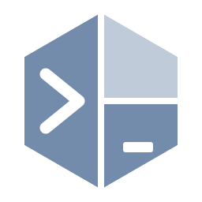

<div align="center">
  
  <h1>pocketosix</h1>
  <p><strong>real unix vibe right in your browser!</strong></p>
</div>

[English](README.md) · **Русский**

Настоящий Alpine Linux userspace, Xorg и i3 на вашем устройстве через CheerpX — не имитация терминала. Браузер показывает desktop и хранит локальный изменяемый диск; сеть гостя через Tailscale необязательна.

## Быстрый старт

Нужны **Node.js ≥ 20.9** (рекомендуется Node.js 24), npm и современный desktop Chrome или Edge.

```powershell
npm install
npm run dev
```

Откройте **[localhost:3000/run](http://localhost:3000/run)** без лендинга и нажмите **`> boot`**. Само открытие страницы не запускает Linux. Для гостевого GUI аккаунт Tailscale не нужен.

## Открыть локальный desktop

После установки зависимостей используйте вместо `npm run dev`:

```powershell
npm run desktop
```

Команда запускает установленный Next.js dev server с webpack на порту **3000** и открывает `/run` в браузере по умолчанию только после сообщения готовности сервера и ответа маршрута HTTP 200. **`> boot`** по-прежнему нажимаете вы.

Занятый порт — ошибка: launcher не переиспользует другой сервер и не меняет origin вашего диска. Если сервер уже работает, откройте `/run` вручную. **Ctrl+C** останавливает только собственный сервер launcher.

[Локальный запуск, приложения, tty1 и управление floating в i3 →](docs/desktop.md)

Панели и tty1-консоль открываются поверх Linux без изменения его размера; над активным desktop остаётся только гостевой курсор. Реальные изменения viewport объединяются за 150 мс; framebuffer ограничен 4096 px по каждой оси. [Управление экраном и вводом](docs/desktop.md#управление-на-run).

## Приложения и гостевые окна

В оболочке **семь панелей**: Приложения, Экран, Терминал, Диск, Сеть, Сочетания клавиш и Логи. Новые действия ниже описаны по текущей реализации, **проверка ещё не завершена**: это не отчёт о реальном гостевом тесте или измеренном ускорении.

- **Приложения → Терминал Linux** запускает гостевой `xterm` внутри Xorg/i3. **Терминал → Открыть терминал** открывает отдельную настоящую **tty1-консоль** в браузере, не этот GUI-терминал.
- **Все приложения** запускает `rofi -normal-window -show drun` как управляемое окно i3. **Файлы · Thunar** соответствует исходному гостевому Files; **Файлы · PCManFM** — отдельная альтернатива, не подтверждённо более быстрая. Действия требуют проверенной живой сессии и найденного приложения; принятие IPC-команды само по себе не означает готовности приложения.
- **Включить плавающие окна** — явное действие только для текущей сессии: открытые tiled и новые обычные окна становятся floating, конфиг i3 не переписывается. **Выключить плавающий режим** возвращает в tiling только ещё видимые окна, переключённые режимом, **не точную прежнюю раскладку tiles**. Уже плавающие окна не затрагиваются, scratchpad-окна никогда не показываются автоматически. Reload не сохраняет режим.
- **Обновить окна** читает настоящий список i3, не отслеживает его непрерывно. **Закрыть** в строке окна запрашивает гостевое закрытие, **Скрыть окно** использует scratchpad без остановки приложения, **Показать окно** явно показывает скрытое окно. Верхняя кнопка **Закрыть** закрывает только браузерную панель. Сначала сохраните документы: приложение может запросить сохранение, а скрытие / обновление списка ничего не сохраняют. Несохранённые документы и процессы не переживают reload или выход.

[Подробности, ограничения и необязательная сохраняемая ручная настройка →](docs/desktop.md)

## Три важных ограничения

- **Экспериментальный x86-32 userspace, не Linux kernel и не полная VM.** Не все Linux-приложения совместимы; успешность каждого запуска не гарантируется.
- **Локально сохраняются записанные изменения диска, не RAM и процессы.** Запись асинхронна: немедленный reload может потерять последние изменения. Хранилище привязано к профилю и origin, это не резервная копия.
- **Нужны сетевые загрузки.** CheerpX и блоки базового диска приходят с внешних серверов. Локальное исполнение не означает offline или скачиваемую самостоятельную ОС.

## Документация

- [Desktop, терминалы и плавающие окна](docs/desktop.md)
- [Сохранение диска, сброс и необязательная сеть](docs/storage-network.md)
- [Разработка, проверки и развёртывание](docs/development.md)
- [Архитектура и границы runtime](docs/architecture.md)
- [Съёмка настоящего продукта](docs/media-capture.md)
- [Прежний технический справочник](docs/reference-redesign2.md) · [исторический отчёт проверок](artifacts/redesign2/README.md)

В приложении маршрут `/docs` также содержит справку English / Русский без загрузки runtime.

## Участие

См. [CONTRIBUTING.md](CONTRIBUTING.md) и [инварианты сопровождения](AGENTS.md). Репозиторий: [Kingrane/pocketosix](https://github.com/Kingrane/pocketosix).

## Лицензии

**Оригинальный код и документация PocketOSix — [MIT](LICENSE)**. CheerpX SDK / runtime proprietary и подчиняется [собственной лицензии](https://github.com/leaningtech/cheerpx-meta/blob/main/LICENSE.txt); для production-использования организацией требуется коммерческое соглашение с Leaning Technologies. MIT не разрешает распространение или self-host runtime. У Alpine, пакетов, шрифтов и обоев отдельные условия: см. [third-party notices](THIRD_PARTY_NOTICES.md). Владелец подтвердил право распространения обоев; MIT проекта на них **не распространяется**.

PocketOSix — независимый проект, не официальный продукт Leaning Technologies или Tailscale.
