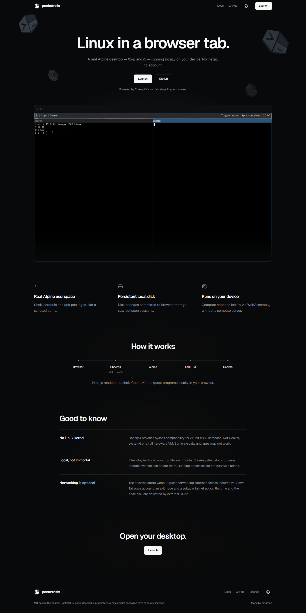
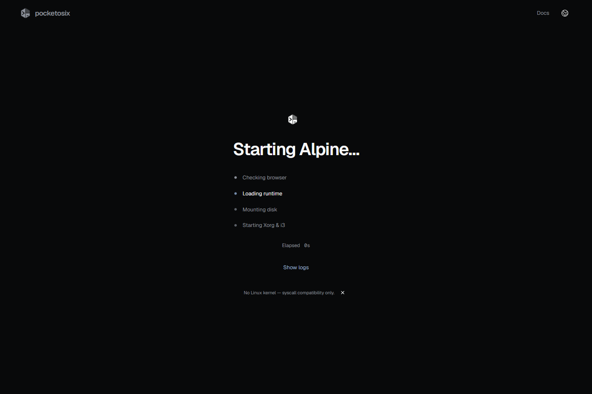
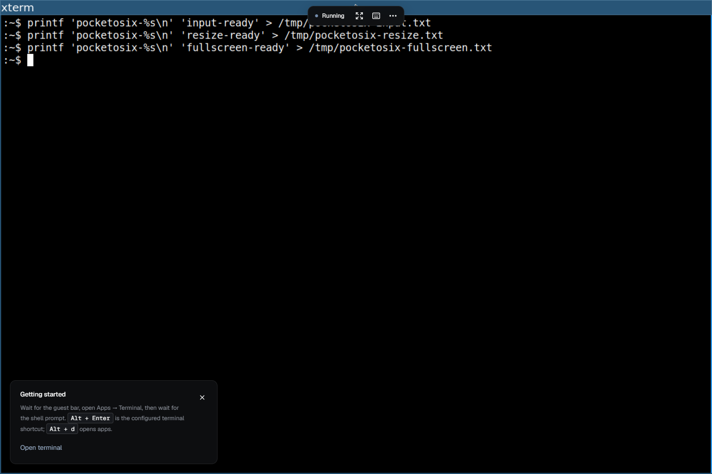
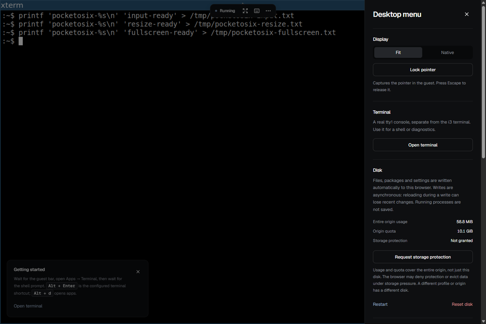

# PocketOSix — финальные скриншоты

22 ноября 2026, локальная production-сборка. Лендинг снят с настоящим `public/hero-desktop.png`, без имитации гостя. Для статических full-page снимков включён `prefers-reduced-motion: reduce`; обычное движение отдельно проверено браузерными тестами.

Снимки `/run` получены при работе настоящего CheerpX / Alpine в отдельном тестовом профиле, не с mock SDK. Ширина 390px — адаптивная оболочка в desktop Chrome, не доказательство работы VM на телефоне. Boot capture показывает реальную текущую стадию, running — выполненные KMS-команды, drawer — меню поверх гостя.

| Состояние | 1440px | 390px |
| --- | --- | --- |
| Лендинг, вся страница | [PNG](landing-1440.png) | [PNG](landing-390.png) |
| Запуск | [PNG](boot-1440.png) | [PNG](boot-390.png) |
| Гость и плавающая панель | [PNG](running-1440.png) | [PNG](running-390.png) |
| Меню | [PNG](drawer-1440.png) | [PNG](drawer-390.png) |

Дополнительно: [лендинг 768px](landing-768.png), русский лендинг [1440px](landing-1440-ru.png) / [768px](landing-768-ru.png) / [390px](landing-390-ru.png), [выбранные обои в настоящем i3](desktop-wallpaper-1440.png).

## Лендинг

## Запуск

## Рабочая система

## Меню

