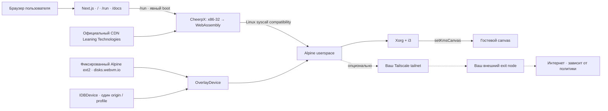

# Архитектура и границы runtime

[README](../README.ru.md) · [Разработка](development.md) · [Диск и сеть](storage-network.md)

PocketOSix показывает **настоящий Linux userspace**, не заранее нарисованный desktop и не canned output. Next.js отвечает за веб-оболочку; CheerpX исполняет программы гостя на устройстве пользователя. Это syscall compatibility для **32-битного x86**, а не настоящий Linux kernel, Docker, systemd или аппаратная VM.

| Слой | Технология / контракт |
| --- | --- |
| Веб-оболочка | Next.js 16 App Router, React 19, TypeScript |
| Исполнение userspace | Официальный `@leaningtech/cheerpx` **1.4.0** |
| Runtime | Browser-only dynamic `import`; официальный npm loader → CDN Leaning Technologies |
| Read-only base | `CloudDevice`, Alpine `alpine_20251007.ext2` |
| Writable root | `OverlayDevice(base, IDBDevice)` в IndexedDB |
| Графика | Гостевой Xorg / i3 → `setKmsCanvas` |
| Ввод | Обрабатывается SDK, без дублирующей synthetic пересылки |
| Guest network | Tailscale, только по действию пользователя |



Исполнение локально, Next.js не предоставляет backend compute. CDN и Tailscale остаются внешними зависимостями. Совместимость произвольных Linux-приложений, 64-битных бинарников, модулей ядра или аппаратного 3D-ускорения не обещается. Доступность canvas для screen reader и мобильный guest UI не заявляются как полностью проверенные.

## Диск и init

Фиксированный base:

```text
wss://disks.webvm.io/alpine_20251007.ext2
```

При ошибке WebSocket — HTTPS fallback по схеме официального WebVM:

```text
https://disks.webvm.io/alpine_20251007.ext2
```

| Mount | Тип |
| --- | --- |
| `/` | `ext2` |
| `/dev` | `devs` |
| `/dev/pts` | `devpts` |
| `/proc` | `proc` |
| `/sys` | `sys` |

Запускается `/sbin/init`, `uid: 0`, `gid: 0`. Read-only `WebDevice` в `/web` открывает ресурсы сайта, включая `/web/assets/alpine_bg.png`, ожидаемый конфигом i3. WebDevice создаётся с пустым префиксом по upstream-схеме: префикс `/` склеивается SDK с `/assets` и может дать URL другого хоста.

## HTTP-ресурсы WebDevice

`app/assets/route.ts` возвращает специальный directory status **231**, распознаваемый WebDevice 1.4.0. Его `stat` делает GET с `Range`: одного HEAD или обычного GET PNG недостаточно. `/index.list` и `/assets/index.list` используют LF, PNG сохраняет **206** и корректный `Content-Range`, без сжатия. HTTP-тест оболочки и настоящие гостевые `stat`, `ls`, чтение PNG — разные проверки.

Выбранные владельцем `public/assets/wallpaper28.png` доступны также как `/web/assets/alpine_bg.png`. Это отдельный HTTP-ресурс, не замена base image / overlay ID; запущенный `feh` может перечитать его только при следующем старте гостя. Право распространения обоев и снимков подтверждено владельцем, но их источник и название лицензии не предоставлены; MIT проекта на них не распространяется. [Notices](../THIRD_PARTY_NOTICES.md).

## Границы компонентов

```text
app/                  # /, /run, /docs и HTTP assets
components/landing/   # лендинг без SDK
components/docs/      # справка без runtime / диска
components/linux/     # canvas, boot, панели, диалоги, tty1
components/ui/        # бренд, общая навигация, язык
hooks/use-linux-desktop.ts  # связь React с жизненным циклом сессии
hooks/use-kms-input.ts      # локальный фокус native SDK textarea
lib/webvm.ts          # адаптер runtime
lib/webvm-config.ts   # конфигурация base / overlay
lib/webvm-state.ts    # состояния
lib/i18n.ts           # загрузка словарей
messages/             # en.json / ru.json
types/cheerpx.d.ts     # только подтверждённые объявления
tests/unit/           # unit checks
tests/browser/        # оболочка и opt-in настоящий runtime
scripts/open-desktop.mjs    # локальный Next launcher, не управление гостем
```

По умолчанию язык English, без автоопределения браузера; выбранный язык хранится в cookie `pocketosix-locale`. Новый язык — JSON-словарь и запись в `languages`, см. [CONTRIBUTING.md](../CONTRIBUTING.md). Только `/run` после явного boot загружает SDK; `/docs` не импортирует runtime-адаптер.

Browser side effects происходят внутри клиентского жизненного цикла, не SSR / module evaluation. StrictMode и cleanup не должны создавать параллельных boots, writers или callbacks; асинхронный runtime не привязывается к размонтированному canvas. Lock освобождается не раньше остановки writer. Reset не является dispose; неподтверждённые методы SDK не добавляются через `any`.

CheerpX 1.4.0 создаёт body-level textarea для native клавиатуры. `use-kms-input.ts` — локальный DOM binding: убирает перекрытие мыши textarea и восстанавливает гостевой фокус после resize, не отбирая фокус у tty1 / browser UI. Fullscreen охватывает документ, чтобы textarea оставался в fullscreen tree. Это не публичный API SDK: при обновлении требуется повторная проверка DOM-сигнатуры и реального ввода. `setCustomConsole` возвращает функцию для настоящей tty1; clipboard → KMS, программные мобильные клавиши и PTY resize нельзя обещать без подтверждённого API.

## Лицензионная граница

[MIT](../LICENSE) покрывает только оригинальный код / документацию PocketOSix. CheerpX SDK / runtime **proprietary**: [лицензия](https://github.com/leaningtech/cheerpx-meta/blob/main/LICENSE.txt), [пояснения](https://cheerpx.io/docs/licensing). Для production организации требуется коммерческое соглашение с Leaning Technologies; бесплатная оценка не разрешает произвольный организационный deployment. Runtime не копируется в `public/`, не перепаковывается и не self-host без отдельного разрешения. Alpine, пакеты и assets имеют собственные лицензии; перенос WebVM-кода требует сохранения Apache-2.0 notices / атрибуции. [THIRD_PARTY_NOTICES.md](../THIRD_PARTY_NOTICES.md).

Официальные источники: [WebVM](https://github.com/leaningtech/webvm), [CheerpX](https://github.com/leaningtech/cheerpx-meta), [Alpine image](https://github.com/leaningtech/alpine-image). PocketOSix не аффилирован с Leaning Technologies или Tailscale. Полный прежний технический текст сохранён в [reference-redesign2.md](reference-redesign2.md).
