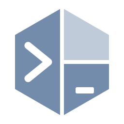
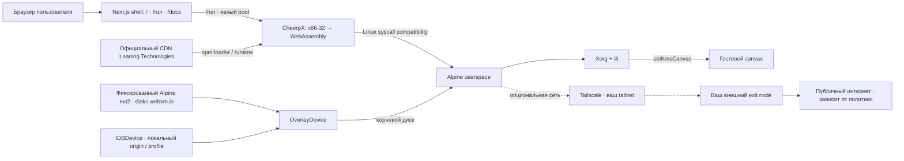

# Архив технического README — REDESIGN2

Этот документ сохраняет прежний README целиком: технические контракты, ограничения и исторические результаты на 22 ноября 2026. Описание лендинга, панели и capture относится к REDESIGN2, а не обещает текущий UI или успешный запуск. Актуальные инструкции: [разработка](development.md), [архитектура](architecture.md), [локальный desktop и floating](desktop.md), [диск и сеть](storage-network.md). Главная страница: [English](../README.md) / [Русский](../README.ru.md).

---

<div align="center">
  
  <h1>pocketosix</h1>
  <p><strong>real unix vibe right in your browser!</strong></p>
  <a href="../LICENSE"></a>
  
</div>

**Версия 0.0.1 — экспериментальная начальная версия.** Веб-оболочка проверена, но стабильность каждого запуска Linux не гарантируется. Известные таймауты запуска, ограничение второго терминала и асинхронное сохранение диска описаны ниже; это не стабильный релиз.

PocketOSix — открытый проект Linux-десктопа в браузере: настоящий Alpine userspace, Xorg и оконный менеджер i3, с локальным сохраняемым диском и необязательной сетью через Tailscale. Next.js отвечает за оболочку приложения; программы гостевой системы исполняет CheerpX на устройстве пользователя.

Это не нарисованная имитация рабочего стола и не терминал с заранее подготовленными ответами. Графика приходит из гостевого Xorg через `setKmsCanvas`, ввод обрабатывает SDK.

Минималистичный лендинг показывает настоящий продукт. Приглушённые объёмные знаки бренда с SVG dither двигаются только в видимом hero: без WebGL и canvas, с паузой вне экрана / в скрытой вкладке и отключением при reduced motion. Секции имеют мягкие нейтральные фоны и однократное появление; без JavaScript содержимое остаётся видимым. На `/run` гостевой экран занимает всю рабочую область; управление находится в одной плавающей панели и выдвижном меню. Справка, выбор языка и настройки доступны без знания i3.

Репозиторий: [Kingrane/pocketosix](https://github.com/Kingrane/pocketosix).

### Настоящий hero-capture

В `public/hero-desktop.png` установлен проверенный, неотредактированный framebuffer **1920×1200** настоящего Xorg / i3. Первый xterm показывает выполненные `uname -a` и `cat /etc/alpine-release` вместо отсутствующего `neofetch`; второй xterm пустой — его работающая shell не заявляется. Полноразмерные тайлы закрывают обои; выбранная планета отдельно видна на снимке в галерее. Приватных файлов, ключей, tailnet IP и браузерного drawer в preview нет. Содержимое терминала не рисовалось и не заменялось canned output. Если файл убрать, лендинг покажет спокойное место для настоящего capture, не имитацию Linux.

Для видео: muted autoplay loop, меньше 3 MB, с PNG/WebP poster. Доступность сборки и настоящее выполнение Linux проверяются отдельно.

## What it is / What it is not

| Что это | Что это не означает |
| --- | --- |
| Настоящий Alpine userspace, Xorg и i3 через CheerpX | Не Linux kernel, не Docker, не systemd и не аппаратная VM |
| Исполнение гостевых программ на устройстве пользователя | Не отсутствие внешней инфраструктуры: runtime / base CDN и Tailscale остаются внешними |
| Writable overlay в IndexedDB | Не snapshot RAM и не перенос работающей сессии |
| Сохранение записанных файлов между reload | Не бессрочная сохранность: квота, eviction и очистка сайта могут удалить данные |
| Опциональный Tailscale | Не готовый интернет: нужны внешний exit node, разрешения и проверка доступа из гостя |
| MIT для оригинального кода и документации PocketOSix | Не MIT для proprietary CheerpX runtime и не разрешение self-host SDK |

## Быстрый старт

Нужны **Node.js ≥ 20.9** (рекомендуется Node.js 24), npm и современный desktop Chrome или Edge. Откройте терминал в каталоге проекта:

```powershell
npm install
npm run dev
```

Адрес: **http://localhost:3000**. Скрипт разработки использует webpack.

- `/` — лендинг; открытие страницы не загружает CheerpX и не запускает гостя.
- `/run` — рабочая область: проверки браузера выполняются тихо; показаны только ошибки. Явно нажмите **`> boot`**. Только этот маршрут загружает официальный SDK после вашего действия.
- `/docs` — справка RU / EN: клавиатура, локальный диск, Tailscale и ограничения; без загрузки runtime.

Интернет на стороне браузера нужен для загрузки CheerpX и блоков базового диска; при первом запуске загрузка может быть продолжительной. Изменения адаптера VM / его конфигурации в dev вызывают полную перезагрузку документа: активный WASM-гость не заменяется новым контроллером через HMR. Файлы диска сохраняются; процессы запускаются заново.

Для production-сборки:

```powershell
npm run build
npm start
```

Гостевой GUI не требует аккаунта или подключения к Tailscale. Это **не** означает работу приложения без интернета: загрузка runtime и базового диска остается внешней сетевой зависимостью.

## Что находится внутри

| Слой | Технология / назначение |
| --- | --- |
| Веб-приложение | Next.js 16 App Router, TypeScript, React 19 |
| Исполнение Linux userspace | Официальный npm-пакет `@leaningtech/cheerpx`, версия **1.4.0** |
| Загрузка runtime | Browser-only dynamic `import`; npm loader загружает runtime с CDN Leaning Technologies |
| Базовый диск | `CloudDevice`, Alpine `alpine_20251007.ext2` |
| Изменяемый диск | `OverlayDevice` поверх базового диска + `IDBDevice` в IndexedDB |
| Графика | Xorg / i3 в госте, `setKmsCanvas` в браузере |
| Сеть гостя | Опциональная интеграция Tailscale, подключение по кнопке |

### Архитектура



Исполнение гостя локально; Next.js не предоставляет backend compute. Стрелки к CDN и Tailscale — реальные внешние зависимости, а не скрытый «сервер Linux».

Основной адрес образа:

```text
wss://disks.webvm.io/alpine_20251007.ext2
```

При ошибке WebSocket используется HTTPS fallback по схеме официального WebVM:

```text
https://disks.webvm.io/alpine_20251007.ext2
```

Корневой `ext2` монтируется в `/`; служебные mounts: `/dev` → `devs`, `/dev/pts` → `devpts`, `/proc` → `proc`, `/sys` → `sys`. Read-only `WebDevice` в `/web` дает гостю доступ к ресурсам сайта, включая обои, ожидаемые конфигурацией i3. Запускается `/sbin/init` с `uid: 0`, `gid: 0`.

Выбранные владельцем обои `public/assets/wallpaper28.png` с планетой обслуживаются также как `/web/assets/alpine_bg.png`. Это отдельный read-only HTTP-ресурс: base образ и overlay ID не менялись. Уже запущенный `feh` может не перечитать фон до следующего запуска гостя. Владелец подтвердил право публикации обоев и скриншотов с ними; название лицензии и источник не предоставлены, MIT проекта на обои не распространяется. См. [THIRD_PARTY_NOTICES.md](../THIRD_PARTY_NOTICES.md).

`app/assets/route.ts` обозначает каталог `/assets` специальным статусом **231**, который распознаёт официальный WebDevice 1.4.0. Его `stat` делает GET с `Range`, поэтому одного HEAD или обычного GET для PNG недостаточно. Списки `index.list` используют LF; PNG должен сохранять ответы `206` с корректным `Content-Range`, без сжатия. Контракт проверяется HTTP-тестом и отдельно настоящими гостевыми `stat`, `ls` и чтением PNG.

**Backend для исполнения гостевых программ не нужен.** Но это не отсутствие внешней инфраструктуры: сайт надо где-то разместить, runtime и диск приходят с CDN, а опциональная гостевая сеть зависит от Tailscale и вашего exit node.

## Управление

Интерфейс English / Русский разделяет лендинг, запуск и справку. По умолчанию English, без автоопределения браузера. Выбор языка хранится в cookie `pocketosix-locale`; все интерфейсные тексты — в `messages/`. До явного boot нет искусственного «успешного запуска», нарисованного Linux или терминала с canned output. Подробный мануал находится на `/docs`.

В рабочем режиме подведите мышь к верхней границе, чтобы показать панель. Кнопка меню открывает настройки, настоящую tty1-консоль, сеть и логи. На гостевой панели нажмите **Apps**, затем **Terminal** и дождитесь приглашения shell перед вводом. Подсказка первого запуска также предлагает кнопку для отдельной tty1-консоли. В конфигурации i3 заданы `Alt + Enter` для терминала и `Alt + D` для списка программ; работоспособность этих сочетаний в текущем браузере нужно проверять отдельно. Ярлыки поверх canvas не подменяют реальные гостевые приложения.

- **Полный экран** — разворачивает приложение; ограничения браузера и ОС на горячие клавиши сохраняются.
- **Справка / Help** — основные действия и ограничения окружения.
- **Логи** — диагностика запуска; отсутствие ошибок в логе само по себе не доказывает успешный запуск Xorg.
- **Сеть** — отдельное, необязательное подключение к Tailscale.
- **Локальный диск** — сведения о хранении и запрос persistent storage у браузера.
- **Перезагрузка** — reload страницы: гостевые процессы запускаются заново; сохраняются изменения, уже записанные в хранилище браузера. Незавершённая запись может потеряться.
- **Сброс / Reset** — после ввода подтверждения перезагружает документ и завершает старую VM. На новом preflight нажмите `> boot`: выбранный overlay очищается до запуска новых гостевых процессов. Файлы, установленные пакеты и настройки на этом диске будут потеряны без возможности отмены.

**Полный экспорт / импорт overlay сейчас недоступен:** безопасный механизм полного backup / restore через официальный SDK не реализован и не проверен. Рабочих шагов «скачать диск» или «импортировать backup» здесь нет. Экспорт целой VM, сохранение RAM и перенос полной сессии между устройствами тоже не поддерживаются. Важные данные не следует хранить здесь в единственном экземпляре.

Вставка из буфера браузера прямо в KMS и программная мобильная панель клавиш недоступны до проверки соответствующего официального API. Shell не пересылает собственные synthetic keyboard / mouse события поверх уже работающего SDK-ввода.

`hooks/use-kms-input.ts` — локальный DOM binding для CheerpX 1.4.0: SDK создаёт невидимый body-level textarea для клавиатуры. Оболочка отключает перекрытие мыши этим элементом и восстанавливает именно гостевой фокус при его пересоздании после resize, не отбирая фокус у tty1 / браузерных окон. Fullscreen включает весь документ, чтобы SDK textarea оставался внутри fullscreen tree. Это не публичный API CheerpX; при обновлении SDK DOM-сигнатуру и реальные сценарии нужно проверить заново.

`Alt + Enter` задан в конфигурации для терминала внутри i3, но в локальных прогонах запуск этим сочетанием не подтвердился. Используйте Apps → Terminal после появления гостевой панели. Boot-вывод сам по себе не означает готовую shell. Приглашение и необходимость login определяются гостевой системой — автоматический вход не обещается.

Докируемый xterm подключён к настоящей **tty1** через возвращаемую функцию `setCustomConsole`. В заводском образе войдите как `user` с публичным заводским паролем `password` (если вы его не меняли). Это не секрет приложения. Докирование и размер тайла меняются; на узком экране док только снизу. Размер tty1 фиксирован **100×30**: документированного API изменения PTY в SDK 1.4.0 нет. Набор в tty1 при активном GUI ещё требует реальной проверки.

### Горячие клавиши i3

В [официальном конфиге Alpine](https://github.com/leaningtech/alpine-image/blob/master/config/i3/config) задано `set $mod Mod1`: обычно это **Alt**, а не Super / Windows. Таблица сверена с upstream-конфигом; при изменении конфигурации в госте используйте фактические bindings своего диска.

| Комбинация | Действие |
| --- | --- |
| `Alt + Enter` | Открыть терминал |
| `Alt + D` | Открыть launcher rofi |
| `Alt + Shift + Q` | Закрыть активное окно |
| `Alt + стрелки` | Переключить фокус |
| `Alt + Shift + стрелки` | Переместить окно |
| `Alt + H` / `Alt + V` | Горизонтальное / вертикальное разбиение |
| `Alt + F` | Полноэкранный режим окна i3, отдельно от fullscreen браузера |
| `Alt + 1…9`, `Alt + 0` | Рабочие пространства 1…10 |
| `Alt + Shift + 1…9`, `Alt + Shift + 0` | Перенести окно в рабочее пространство |
| `Alt + Shift + Space` | Переключить floating / tiling |
| `Alt + R` | Режим изменения размера; `Enter` или `Escape` — выход |

Сначала щелкните по гостевому экрану. Часть сочетаний может перехватывать ОС или браузер; таблица не является гарантией доставки каждого сочетания на любой платформе.

## Что сохраняется

Локальные изменения корневого диска хранятся в IndexedDB:

```text
pocketosix-alpine-20251007-v1
```

Сохраняются **файлы, установленные пакеты и настройки**, записанные на корневой диск. **Процессы и RAM не сохраняются**: закрытие вкладки или reload завершает гостевую сессию. Виртуальные `/proc`, `/sys`, `/dev` не являются хранилищем пользовательских данных.

**Запись в браузер асинхронная.** В диагностике 22 ноября гостевые `sync` и `cat` завершились до появления данных в committed IDB-блоках; немедленный reload потерял тестовый файл. После фактического IDB commit файл пережил reload. Это не исправлено изменением runtime: публично поддерживаемый durable-flush API SDK 1.4.0 не подтверждён, поэтому кнопка Save и гарантия мгновенного сохранения не добавлены. Важные данные не храните здесь в единственном экземпляре. Тесты committed persistence сначала read-only проверяют маркер в настоящей IDB-базе, затем сохраняют проверку гостевого чтения после reload; это не доказательство завершения всех очередей записи.

Хранилище привязано одновременно к **browser profile и origin** — схеме, хосту и порту:

- `http://localhost:3000` и deployment имеют разные диски;
- другой браузер, профиль, домен, порт или preview URL — отдельное хранилище;
- очистка данных сайта удаляет локальный диск;
- приватный режим не подходит для долговременного хранения;
- браузер устанавливает квоту и может вытеснять данные (eviction).

По запросу пользователя приложение вызывает `navigator.storage.persist()`. Браузер может отказать; разрешение снижает риск eviction, но не защищает от ручной очистки и не заменяет резервную копию. `navigator.storage.estimate()` оценивает usage / quota **всего origin**, не точный размер файлов гостя и не размер полного образа. Запись защищается через `navigator.locks`: две вкладки одного origin не должны одновременно изменять один диск. Перед повторным запуском закройте вкладку, которая уже владеет диском.

**Образ и overlay образуют неразрывную пару.** Нельзя заменить базовый образ, сохранив старый ID: overlay содержит изменения блоков конкретного `ext2`. При обновлении или смене образа нужен новый ID и отдельный диск; автоматическая миграция данных не подразумевается.

Базовый диск стримится по сети. Наличие IndexedDB-overlay **не гарантирует offline-работу** и не означает, что весь базовый образ уже скачан.

## Сеть гостевой системы

Tailscale включается только по действию пользователя. Без него доступны GUI и локальные программы, которым не нужен сетевой доступ из гостя.

Для доступа гостя в публичный интернет:

1. Откройте сетевую панель и начните подключение к Tailscale.
2. Войдите в свой аккаунт и подтвердите подключение браузерного устройства.
3. Настройте и разрешите **внешний exit node** в своем tailnet — Windows PC, Linux-машину или VPS. См. [официальную инструкцию Tailscale](https://tailscale.com/kb/1408/quick-guide-exit-nodes).
4. Проверьте доступ из гостя, например через `curl` или `wget`, если они установлены. Не используйте `ping` как единственный критерий: низкоуровневые сетевые операции могут быть недоступны.

Сам аккаунт Tailscale без exit node не дает обещания выхода в публичный интернет. Доступ также зависит от ACL, политики tailnet и доступности exit node. PocketOSix не предоставляет общий exit node.

**Не добавляйте Tailscale auth keys в код, `.env`, публичные URL, логи или репозиторий.** Любая переменная `NEXT_PUBLIC_*` попадает в клиентскую сборку и не может хранить секрет. Сетевое подключение может дать гостю доступ к вашей частной сети — подключайте только доверенное окружение.

## Требования браузера и развертывания

Основная целевая среда — desktop Chrome / Edge. Работа в других браузерах и на мобильных устройствах не заявляется как проверенная. Нужны WebAssembly, SharedArrayBuffer, IndexedDB, Web Locks и безопасный контекст: **HTTPS или localhost**.

Для cross-origin isolation должны сохраняться заголовки, заданные в `next.config.ts` и `vercel.json`:

```http
Cross-Origin-Opener-Policy: same-origin
Cross-Origin-Embedder-Policy: require-corp
```

Проверяйте фактический ответ сервера и `window.crossOriginIsolated`, а не только наличие настроек в файле. При `COEP: require-corp` внешние ресурсы должны удовлетворять требованиям CORS / CORP; произвольный CDN или reverse proxy может заблокировать загрузку.

### Vercel

1. Импортируйте репозиторий как Next.js-проект, установите подходящую версию Node.js и используйте `npm run build`.
2. Сохраните заголовки из `vercel.json`; не удаляйте эквивалентные настройки `next.config.ts` для локального и другого хостинга.
3. Выберите **постоянный production-домен** для пользовательского диска. У каждого preview origin будет свое хранилище; смена домена не переносит IndexedDB.
4. Проверьте HTTPS, cross-origin isolation и загрузку runtime / образа с нужными CORS / CORP-заголовками.
5. Не проксируйте многогигабайтный базовый образ через serverless functions. Используйте прямой совместимый источник диска.
6. Оставьте загрузку CheerpX runtime с официального CDN. Копирование runtime на свой сервер требует отдельного разрешения по лицензии.

Deployment веб-оболочки не означает, что на Vercel исполняется Linux-гость: compute остается в браузере.

## Необязательная конфигурация диска

По умолчанию переменные не нужны. Для собственного образа скопируйте пример в локальный файл:

```powershell
Copy-Item ".env.example" ".env.local"
```

| Переменная | Назначение |
| --- | --- |
| `NEXT_PUBLIC_DISK_URL` | URL собственного, совместимого `ext2`-образа |
| `NEXT_PUBLIC_DISK_BACKEND` | `cloud` или `bytes`; backend должен соответствовать источнику |
| `NEXT_PUBLIC_DISK_ID` | Уникальный ID IndexedDB-overlay для этой версии образа; префикс `pocketosix-`, далее буквы, цифры, `-` или `_` |
| `SITE_URL` | Настоящий origin публикации для OG/Twitter, robots и sitemap; server-side build-time настройка, без секретов |

Если `SITE_URL` не задан, используется `VERCEL_PROJECT_PRODUCTION_URL`, а локально — фактический `http://localhost:3000`. Перед публикацией вне Vercel задайте адрес и пересоберите приложение.

При использовании собственного образа задайте все три переменные и **обязательно измените `NEXT_PUBLIC_DISK_ID`**, например на `pocketosix-my-alpine-v1`. Одной смены URL недостаточно. Даже обновление содержимого по прежнему URL требует новой версии ID; базовые образы должны быть неизменяемыми. Backend `bytes` использует `HttpBytesDevice` и HTTP(S)-источник, не WSS. Убедитесь в совместимости источника с CORS / COEP и API выбранного backend. `NEXT_PUBLIC_*` — публичная build-time конфигурация, не место для учетных данных. После ее изменения пересоберите production-приложение.

## Структура проекта

```text
app/
  page.tsx                 # лендинг /
  run/page.tsx             # рабочая область /run
  docs/page.tsx            # справка /docs
  assets/route.ts          # маркер каталога WebDevice (231)
  layout.tsx
  globals.css
components/ui/             # бренд, навигация, общий переключатель языка
components/landing/        # лендинг, без CheerpX
components/docs/           # справка, без SDK и доступа к диску
components/linux/
  linux-desktop.tsx
  desktop-toolbar.tsx
  desktop-dialog.tsx
  boot-screen.tsx
  guest-terminal.tsx       # отдельная настоящая tty1
hooks/
  use-linux-desktop.ts
  use-kms-input.ts         # фокус native SDK textarea, без пересылки событий
messages/
  en.json                  # все интерфейсные тексты English
  ru.json                  # все интерфейсные тексты Русский
lib/
  i18n.ts                  # языки, загрузка JSON, lookup
  site-links.ts            # публичные ссылки проекта
  webvm.ts
  webvm-config.ts
  webvm-state.ts
types/
  cheerpx.d.ts
tests/
  unit/
  browser/
.env.example
next.config.ts
vercel.json
package.json
```

`lib/webvm.ts` изолирует взаимодействие с runtime, конфигурация диска находится в `lib/webvm-config.ts`, состояния — в `lib/webvm-state.ts`. Hook связывает жизненный цикл браузерной сессии с React; компоненты строят оболочку вокруг настоящего гостевого canvas. `/docs` использует общий язык интерфейса и JSON-словарь; он не импортирует runtime-адаптер или SDK. Новый язык — один JSON-файл и строка в `languages`; см. [CONTRIBUTING.md](../CONTRIBUTING.md).

## Проверки

```powershell
npm run typecheck
npm run lint
npm test
npx playwright install chromium
npm run test:e2e
npm run test:vm
```

- `typecheck` — проверка TypeScript.
- `lint` — статические правила проекта.
- `test` — Node unit tests через `tsx`.
- `test:e2e` — детерминированные Playwright-тесты веб-оболочки: явный boot, StrictMode, disk lock, cookie EN/RU, drawer / toolbar, native KMS textarea, resize / fullscreen и изоляция ввода в диалогах. Mock SDK и его кадры не подтверждают Linux.
- `test:vm` — отдельная **opt-in** интеграционная проверка настоящего runtime. Четыре сценария: tty1 login и anti-echo shell marker; tty1 запись / reload / confirmed reset; WebDevice directory stat / listing / чтение PNG; Polybar Apps → Terminal, KMS-команды, resize / fullscreen, lock второй вкладки и файл → reload → confirmed reset. GUI-приложения запускаются настоящими кликами, не диагностическим `run()`. Результат KMS-команды проверяется по файлу через read-only `run()` и exit status, а не по выводу неактивной tty1. Нужны сеть, Chromium и ресурсы для тяжелого WebAssembly. Не меняйте адаптер во время прогона; для стабильной проверки используйте заранее запущенный `npm start`.

Наличие скрипта не является результатом проверки. Точный охват интеграционного теста следует смотреть в `tests/`; загрузка canvas сама по себе не доказывает работающий i3, персистентность или сеть. При публикации результатов указывайте команду, браузер, окружение и фактический результат, включая пропуски.

### Диагностика реального гостя

По умолчанию `test:vm` использует Chromium из Playwright. Для установленного
Chrome или Edge можно выбрать соответствующий канал; профиль теста остается
отдельным от пользовательского:

```powershell
$env:POCKETOSIX_VM_BROWSER = "chrome" # или msedge
$env:POCKETOSIX_VM_DIAGNOSTICS = "1"
$env:POCKETOSIX_VM_CAPTURE = "1" # необязательный настоящий hero-capture
npm run test:vm -- --headed --trace=off
Remove-Item Env:POCKETOSIX_VM_BROWSER, Env:POCKETOSIX_VM_DIAGNOSTICS, Env:POCKETOSIX_VM_CAPTURE
```

Это переменные тестового runner, не `NEXT_PUBLIC_*` и не настройки deployment.
Диагностика сохраняет гостевую и браузерную консоли, фактический framebuffer и
его размеры в HTML-отчете. Opt-in `observe-sdk.ts` загружает неизмененный runtime
с официального CDN и записывает созданный экземпляр только в тестовой странице;
после ошибки пытается прочитать гостевые логи через документированный `run()`.
Эта попытка ограничена по времени и не считается подтверждением готовности.
Диагностический wrapper не входит в production-приложение и не имитирует Linux.

При проблемах ввода добавьте `POCKETOSIX_VM_INPUT_TRACE=1`: opt-in трасса сохраняет DOM focus / key events и неизменённые сообщения SDK worker в тестовом отчёте. Она работает только в изолированной тестовой странице, не пересылает дополнительные события и не входит в production.

Необязательный hero-capture сохраняется в `test-results`, не устанавливается на лендинг автоматически. Перед копированием в `public/hero-desktop.png` проверьте настоящие окна, вывод и отсутствие приватных данных. Успешный текстовый ввод в xterm сам по себе не подтверждает `Alt + Enter`.

Чтобы отдельно проверить докируемую tty1 (настоящий login и исполнение `printf`, без ложного успеха от echo): тест ждёт вывод `/dev/tty1` и login, а не готовность Xorg. Его успех не подтверждает GUI.

```powershell
$env:POCKETOSIX_VM_BROWSER = "chrome"
$env:POCKETOSIX_VM_DIAGNOSTICS = "1"
npm run test:vm -- --headed --trace=off --grep "real tty1"
Remove-Item Env:POCKETOSIX_VM_BROWSER, Env:POCKETOSIX_VM_DIAGNOSTICS
```

Тесты создают отдельный профиль и не используют пользовательский диск. WebDevice открывается с пустым префиксом по схеме upstream; `/index.list` и `/assets/index.list` позволяют гостю обнаружить выбранные обои. Префикс `/` недопустим: SDK склеивает его с `/assets` и получает URL другого хоста.

### Фактически выполненные проверки

REDESIGN2, Windows / Node.js 24, 22 ноября 2026, production `http://localhost:3000`:

| Проверка | Результат |
| --- | --- |
| `npm run typecheck`, `npm run lint`, `npm test`, `npm run build` | Прошли; unit suite 10/10 |
| `npm run test:e2e -- --reporter=list --output=…` | 40/40; оболочка, гонка возврата фокуса, EN/RU metadata, HTTP-контракт assets, offscreen / reduced motion, focus reveal и SSR без JavaScript; не доказательство Linux |
| Lighthouse 13.6.0, mobile / desktop, финальный лендинг с настоящим preview и motion | Performance 95 / 100; Accessibility, Best Practices, SEO — 100 / 100; [JSON-результаты](../artifacts/redesign2/lighthouse-summary.json) |
| Настоящие гостевые WebDevice syscalls | Каталог, listing и чтение PNG подтверждены; обои видны в i3 |
| Настоящий tty1 login и shell command | Anti-echo marker подтверждён отдельным прогоном |
| Настоящий tty1 committed persistence / reset | Файл после IDB commit пережил reload; подтверждённый reset удалил его в тестовом профиле |
| Настоящий GUI | Apps → Terminal, KMS-команды, resize / fullscreen, lock второй вкладки, committed persistence и reset прошли assertions в последнем полном прогоне; optional capture завершился ошибкой |

Последний завершённый полный `test:vm -- --headed --trace=off` с `POCKETOSIX_VM_BROWSER=chrome`, `POCKETOSIX_VM_DIAGNOSTICS=1` и `POCKETOSIX_VM_CAPTURE=1`: **3/4 за 11,0 минуты**. После исправления гонки возврата фокуса все основные GUI assertions завершились; ошибка только в optional hero-capture: второй xterm существует, но пиксели его shell prompt не появились (`real-vm.spec.ts:306`, 0 вместо >10 за 30 секунд). Это **не** passing всего suite и не подтверждение работоспособности второго терминала. Тест не ослаблен. Предыдущий immediate-reload прогон потерял файл до IDB commit; смена теста на committed persistence не устраняет эту границу runtime. `Alt + Enter` пока не открыл терминал в реальных прогонах; причина не установлена. Реальный Tailscale, интернет через exit node и production deployment не проверялись. Ничего не публиковалось автоматически.

Дополнительный отдельный захват плавающего терминала с видимыми обоями не завершён: первая попытка остановилась до появления кадра xterm, следующая достигла таймаута 300 секунд на стадии `starting`. Причина второго зависания не установлена; это не успешный boot. Проверенный прежний framebuffer оставлен без изменений, дальнейшие capture-retries не запускались.

### Скриншоты и удалённые элементы

[Галерея 1440 / 390px](../artifacts/redesign2/screenshots/README.md): полный лендинг, реальный boot, работающий гость с панелью и открытое меню. Дополнительно сняты лендинг 768px и все три ширины на русском. [SHA256-проверка](../artifacts/redesign2/protected-hashes.json) подтверждает отсутствие изменений в runtime-адаптере, конфигурации диска, VM-состояниях, React session hook и COOP / COEP конфигурации.

Удалены прежние prism / WebGL renderer и его fallback, «рабочие пространства» лендинга, sidebar / Tile / WorkspaceBar, старые декоративные архитектурные и copy-модули, повторяющиеся панели статуса. Новые dither-логотипы — отдельный лёгкий фон, добавленный по последующему пожеланию; прежний WebGL hero не возвращён. Браузерные проверки находятся только в `/run`, без загрузки гостя на лендинге.

## Известные границы

- Только поддерживаемый 32-битный x86 userspace; нет гарантии запуска произвольного Linux ПО, 64-битных бинарников или модулей ядра.
- Это не среда с настоящим kernel, Docker daemon, systemd или прямым доступом к железу; аппаратное 3D-ускорение не обещается.
- Запуск зависит от сети, политики браузера, памяти и доступности официальной инфраструктуры. Offline и одинаковая производительность на любых устройствах не обещаются.
- Browser storage — не надежный единственный архив. Квота, eviction, очистка сайта и сброс могут уничтожить локальные изменения.
- Перезагрузка не сохраняет процессы, терминальные сессии и RAM; сохранение диска не равно snapshot VM.
- Полная доступность гостевого canvas для screen reader не заявляется; доступность веб-оболочки проверяется отдельно.

## Участие и лицензии

Правила разработки: [CONTRIBUTING.md](../CONTRIBUTING.md). Инварианты для сопровождающих и coding agents: [AGENTS.md](../AGENTS.md).

**Оригинальный код и документация PocketOSix — MIT**, см. [LICENSE](../LICENSE). Эта лицензия **не распространяется** на CheerpX runtime / SDK, Alpine-образ, Linux-пакеты и другие сторонние компоненты. Открытая лицензия оболочки не делает весь исполняемый стек open source.

CheerpX — proprietary runtime Leaning Technologies. Использование в личном проекте подчиняется условиям пакета `@leaningtech/cheerpx` и [лицензии CheerpX](https://github.com/leaningtech/cheerpx-meta/blob/main/LICENSE.txt), включая ограничения допустимых целей. Для production-использования организацией требуется коммерческое соглашение; бесплатную техническую оценку нельзя трактовать как разрешение на любой организационный deployment. MIT PocketOSix не дает права на неограниченное использование, модификацию или самостоятельный хостинг runtime. При сомнениях согласуйте сценарий с Leaning Technologies.

Пакеты Alpine имеют собственные лицензии и требования к notices / исходникам. Право публикации пользовательских обоев подтверждено владельцем, но их источник и название лицензии не предоставлены: см. [THIRD_PARTY_NOTICES.md](../THIRD_PARTY_NOTICES.md). Если переносите код или assets WebVM, сохраняйте их исходные лицензии и notices; не перелицензируйте их как наш MIT-код.

### Официальные источники

- [WebVM](https://github.com/leaningtech/webvm) — эталонная интеграция и конфигурация Alpine.
- [CheerpX](https://github.com/leaningtech/cheerpx-meta) — SDK, документация и условия runtime.
- [Alpine image](https://github.com/leaningtech/alpine-image) — сборка гостевого образа и конфиг i3.
- [CheerpX licensing](https://cheerpx.io/docs/licensing) — официальные пояснения по лицензированию.

PocketOSix — самостоятельный проект, не официальный продукт и не аффилированная разработка Leaning Technologies или Tailscale.
